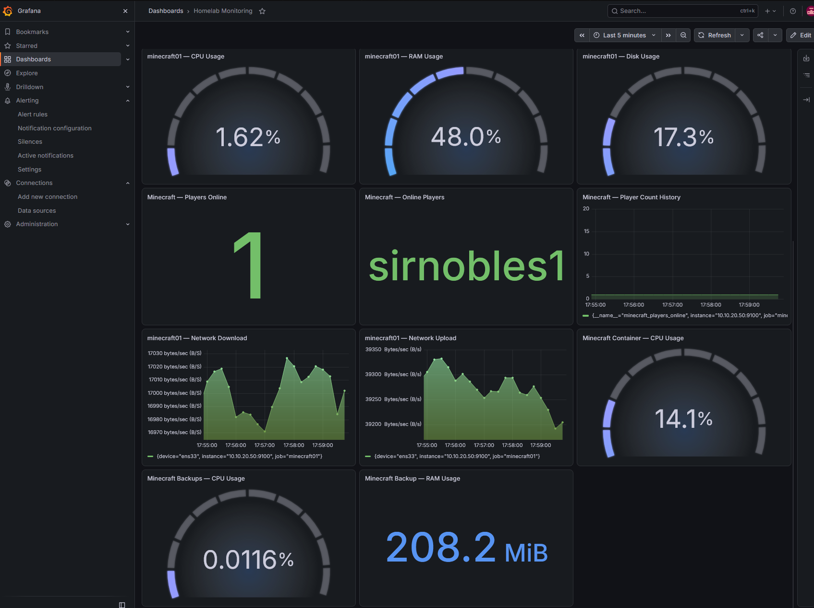
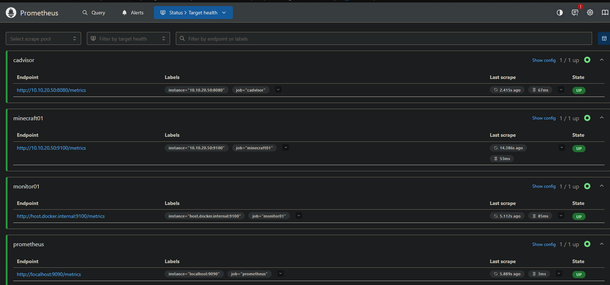
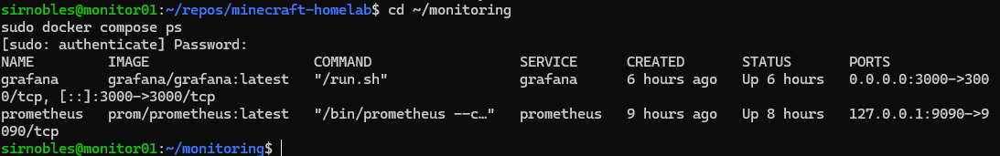
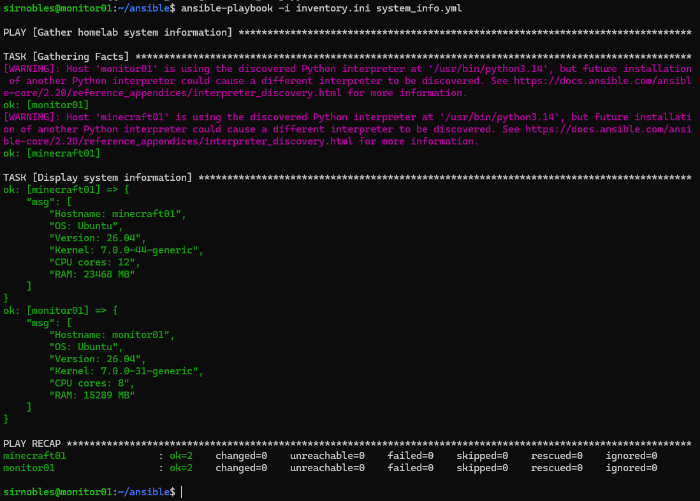
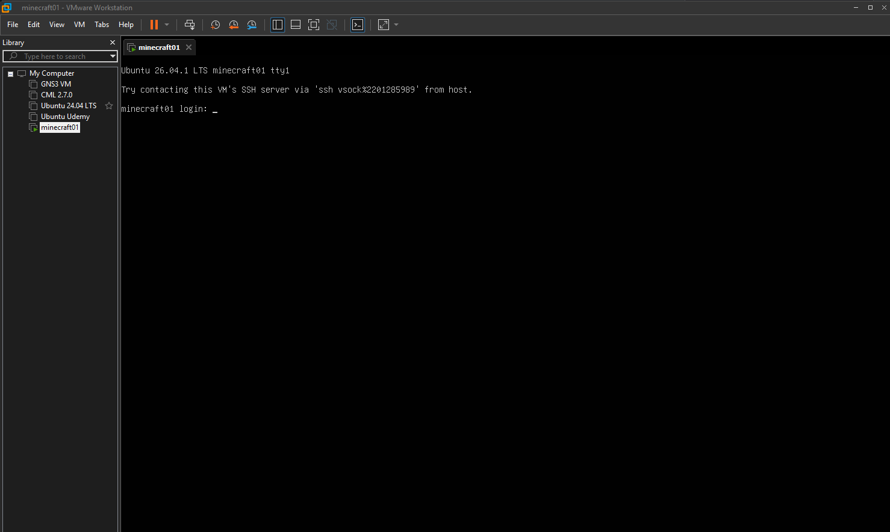
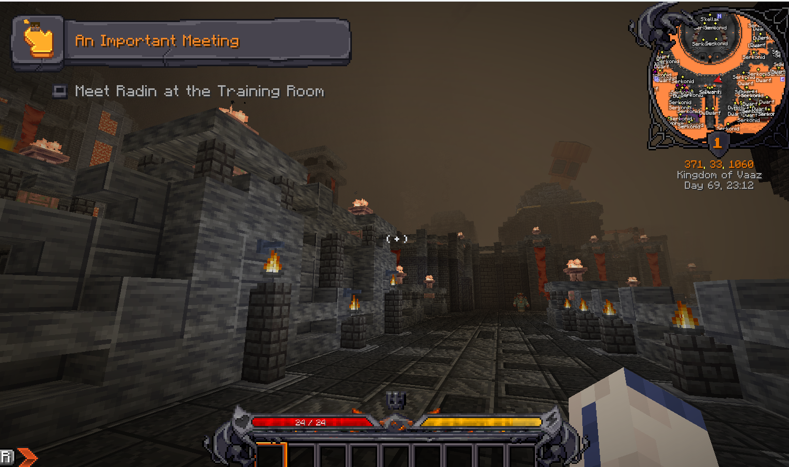

# Minecraft Homelab Infrastructure

## Project Overview

A self-hosted Minecraft server infrastructure project designed to develop practical experience in Linux administration, networking, virtualization, containerization, monitoring, security, and infrastructure automation.

This project applies IT infrastructure and DevOps concepts in a functional homelab environment that supports a modded Minecraft server.

## Project Objectives

- Deploy and maintain a Linux-based Minecraft server.
- Configure networking and external connectivity.
- Implement containerized services.
- Monitor infrastructure health and resource utilization.
- Implement backup and recovery procedures.
- Automate administrative tasks using Ansible and Python.
- Maintain version-controlled infrastructure and documentation.

## Technology Stack

| Technology | Purpose |
|---|---|
| Ubuntu Server | Linux administration |
| VMware Workstation | Virtualization |
| UniFi | Network infrastructure |
| SSH | Secure remote administration |
| Docker | Containerization |
| Docker Compose | Container orchestration on a single host |
| Nginx | Web server |
| Git and GitHub | Version control |
| Prometheus | Metrics collection |
| Grafana | Monitoring and visualization |
| Ansible | Infrastructure automation |
| Python | Scripting and automation |
| No-IP | Dynamic DNS |

## Infrastructure

| Host | Role |
|---|---|
| minecraft01 | Minecraft server virtual machine |
| monitor01 | Monitoring and automation host |
| UniFi Dream Router 7 | Network gateway and firewall |

## Project Repositories

| Repository | Purpose |
|---|---|
| [Minecraft Homelab VM](https://github.com/Aaron24000/minecraft-homelab-vm) | Virtual machine infrastructure |
| [Minecraft Homelab Networking](https://github.com/Aaron24000/minecraft-homelab-networking) | Network configuration |
| [Minecraft Homelab Nginx](https://github.com/Aaron24000/minecraft-homelab-nginx) | Containerized web services |
| [Minecraft Homelab Backups](https://github.com/Aaron24000/minecraft-homelab-backups) | Backup and recovery |
| [Minecraft Homelab Python](https://github.com/Aaron24000/minecraft-homelab-python) | Python scripting and automation |
| [Minecraft Homelab Ansible](https://github.com/Aaron24000/minecraft-homelab-ansible) | Infrastructure automation and configuration management |

## Architecture

Architecture diagrams and infrastructure documentation are maintained within this repository.

## Skills Demonstrated

- Linux system administration
- Network configuration
- Virtual machine management
- Container deployment
- Infrastructure monitoring
- Secure remote access
- Backup and recovery
- Configuration management
- Python scripting
- Git version control
- Technical documentation
- Infrastructure troubleshooting

## Project Status

Operational — undergoing continued documentation and improvement.

## Technical Documentation

| Document | Description |
|---|---|
| [Architecture Diagram](diagrams/architecture.md) | Homelab architecture and service relationships |
| [Infrastructure](docs/infrastructure.md) | Hardware, virtualization and Linux infrastructure |
| [Monitoring](docs/monitoring.md) | Prometheus, Grafana and metrics collection |
| [Security](docs/security.md) | SSH, firewall, DDNS and service exposure |
| [Automation](docs/automation.md) | Ansible and Python automation |
| [Operations Runbook](docs/operations.md) | Maintenance, troubleshooting and recovery |

## Infrastructure Screenshots

### Grafana Monitoring Dashboard

### Prometheus Monitoring Targets

### Docker Compose Services

### Ansible Playbook Execution

### VMware Virtualization

### Operational Minecraft Server

