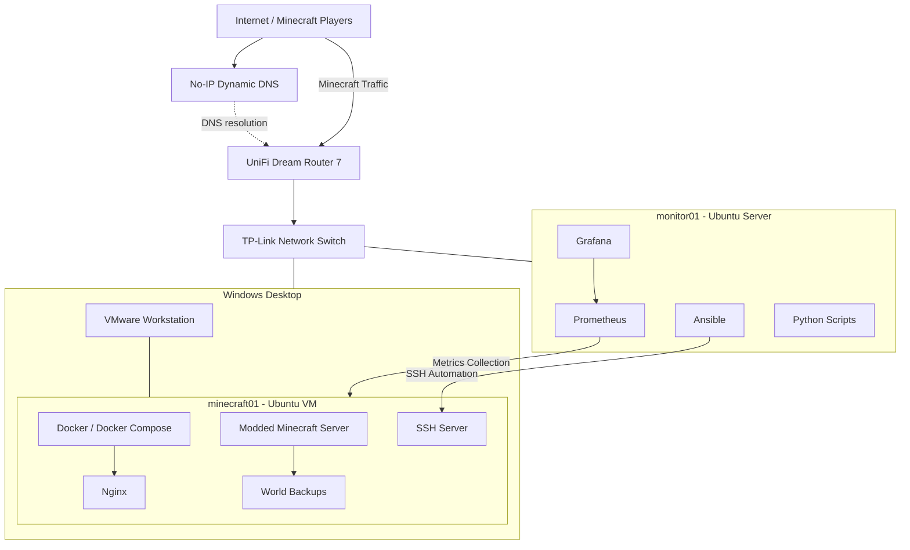

# Homelab Architecture

## Infrastructure Diagram

## Architecture Overview

The homelab consists of two Linux systems with separate
responsibilities for application hosting, infrastructure
monitoring, and automation.

The UniFi Dream Router 7 manages network connectivity,
firewall rules, and external Minecraft access.

The minecraft01 virtual machine hosts the modded
Minecraft server and supporting services.

The monitor01 server hosts infrastructure monitoring
and administrative automation tools.

## Security Considerations

- SSH key-based authentication
- Restricted external service exposure
- Router and firewall management
- Internal monitoring services
- Minecraft world backups

Public IP addresses, credentials, private SSH keys,
and personal connection details are intentionally
excluded from public documentation.
